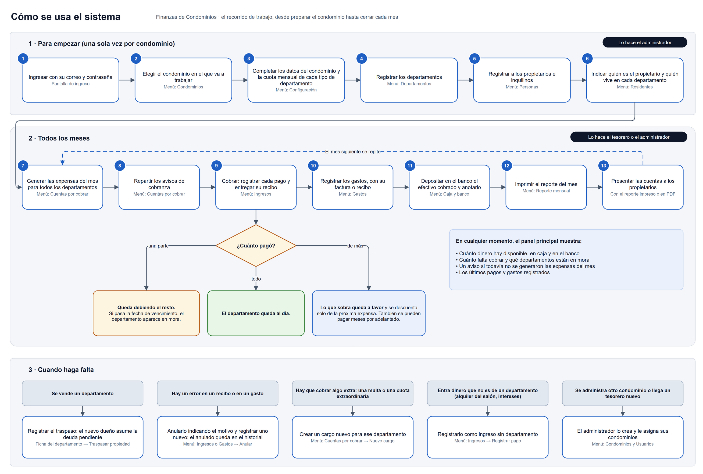

# Finanzas de Condominios

Sistema web para administrar el dinero de uno o varios condominios: expensas y otros cobros, pagos recibidos, gastos, caja y banco, deudas y reportes para los propietarios.

**Tecnologías:** Node.js, Express, React, PostgreSQL · arquitectura MVC (router → controller → model).

---

## Usuarios de prueba

| Rol | Correo | Contraseña | Qué puede hacer |
|---|---|---|---|
| Administrador | `admin@condominio.com` | `Admin2026` | Todo, en todos los condominios |
| Tesorero | `tesorero@condominio.com` | `Tesorero2026` | Cobrar, registrar gastos, cargos y residentes, solo en su condominio |

Se crean con `npm run demo` (ver la instalación). Son solo para probar: en un uso real se crean desde la pantalla **Usuarios** y cada uno cambia su contraseña con el ícono de llave del menú.

---

## Instalación

Requisitos: **Node.js 22.9 o superior** y **PostgreSQL**.

1. Instalar las dependencias:
   ```
   npm install
   ```
2. Copiar `.env.example` como `.env.local` y completar los datos de la base de datos. Para `SESSION_SECRET` genere un texto aleatorio con:
   ```
   node -e "console.log(require('crypto').randomBytes(32).toString('hex'))"
   ```
3. Crear las tablas: ejecutar `database/schema.sql` en la base de datos (por ejemplo, en el Query Tool de pgAdmin). Crea todo en el esquema `final`, con datos de ejemplo.
4. Crear los usuarios de prueba:
   ```
   npm run demo
   ```
5. Iniciar el sistema:
   ```
   npm run dev
   ```
   y abrir <http://localhost:3000>.

> **¿Ya tenía una base de una versión anterior?** No ejecute `schema.sql`: aplique en orden las migraciones que le falten, por ejemplo `npm run migrar -- database/migracion_fase5.sql`, hasta la fase 8.

---

## Datos de ejemplo

Al crear la base con `schema.sql` el sistema ya trae:

- El condominio **Mi Condominio** con 4 tipos de departamento: Básico (Bs 350 al mes), Clásico (Bs 500), Suite (Bs 700) y Suite doble (Bs 950).
- 3 departamentos:
  - **A-101**: propietaria Ana Pérez.
  - **A-201**: propietario Luis Gómez, con María Rojas como inquilina.
  - **B-301**: sin propietario.
- La expensa de noviembre de 2026 de cada departamento, todavía sin pagar.
- Tipos de ingreso (Expensas, Multa, Alquiler de área común…) y de gasto (Servicios, Sueldos, Mantenimiento…).

---

## Diagramas

En la carpeta [docs](docs) están los dos diagramas, como archivo de draw.io (se abre y edita con draw.io o con su extensión de VS Code) y como imagen:

| Diagrama | Qué muestra |
|---|---|
| [Flujo de uso](docs/flujo-de-uso.png) ([.drawio](docs/flujo-de-uso.drawio)) | Cómo se usa el sistema, paso a paso y sin términos técnicos |
| [Diagrama entidad-relación](docs/diagrama-er.png) ([.drawio](docs/diagrama-er.drawio)) | Las tablas de la base de datos, sus columnas y cómo se relacionan |



---

## Ayuda dentro del sistema

El sistema está pensado para alguien que nunca llevó las cuentas de un condominio, y se explica solo:

- **Guía de cada pantalla.** La primera vez que entra a una pantalla, una guía corta resalta sus partes y explica para qué sirve cada una. Se avanza con **Siguiente** (o la flecha derecha) y se cierra con **Saltar guía** (o Escape). Para verla otra vez, pulse **Guía de esta pantalla** en la barra superior.
- **El «?» junto a las cifras.** Pase el mouse (o toque) el signo de pregunta para ver qué significa «Por cobrar», «Mora», «Saldo a favor», «Disponible» y otros términos.
- **Primeros pasos.** En un condominio nuevo, el panel muestra la lista de lo que falta para empezar a cobrar (tipos y cuotas, departamentos, propietarios, expensas, primer pago). Cada paso tiene su botón **Hacerlo ahora** y se marca solo cuando está hecho.
- **Ayuda y glosario** (menú General). Los pasos del trabajo, de la puesta en marcha al cierre del mes, con un enlace a la guía de cada pantalla; preguntas frecuentes («¿Qué pasa con la deuda si se vende un departamento?») y el glosario completo.
- **Tablas vacías que dicen qué hacer.** Si una lista todavía no tiene datos, explica para qué sirve y ofrece el botón para registrar el primero. Después de registrar un pago, el aviso trae el enlace **Ver e imprimir el recibo**.

---

## Cómo se usa: recorrido de prueba

Este recorrido muestra todo el sistema en unos 15 minutos. Siga los pasos en orden, ingresando como **administrador**. Si quiere, deje que la guía de cada pantalla se abra sola la primera vez.

### 1. Panel principal
Muestra el dinero disponible (separado en caja y banco), el resultado del mes, lo que falta cobrar, la ocupación y los departamentos con deuda. Si falta emitir las expensas del mes, aparece un aviso con el botón **Generar expensas**. En el condominio de ejemplo también aparece **Primeros pasos**, porque B-301 todavía no tiene propietario y aún no se registró ningún pago.

### 2. Preparar el condominio (Configuración)
- **Datos del condominio**: nombre, NIT, teléfono y el día del mes en que vencen las expensas. Salen en los recibos.
- **Tipos de departamento**: cada tipo define la cuota mensual. También se configuran los tipos de ingreso y de gasto.

### 3. Personas, departamentos y residentes
- **Personas**: registre a una persona nueva, con su CI o NIT (sale en los recibos).
- **Departamentos**: cada uno tiene un tipo (y con él su cuota). Haga clic en el número de un departamento para abrir su **ficha**: estado de cuenta, pagos, residentes e historial de propietarios.
- **Residentes**: une personas con departamentos como propietario, inquilino o familiar.

### 4. Emitir lo que se cobra (Cuentas por cobrar)
- **Generar expensas**: elija un mes y el sistema crea la expensa de cada departamento activo con la cuota de su tipo. No duplica las que ya existen.
- **Nuevo cargo**: para cobros sueltos, como una multa o una cuota extraordinaria.
- Cada cargo muestra cuánto se pagó, cuánto falta y su estado: pendiente, parcial, pagado o vencido.

### 5. Cobrar (Ingresos)
1. En Cuentas por cobrar, pulse el ícono **Cobrar** de la fila de A-101 (o vaya a Ingresos → Registrar pago).
2. Antes de guardar, la parte derecha muestra **cómo se aplicará el pago**: cubre primero la deuda más antigua.
3. Pruebe pagar de más (lo que sobra queda como saldo a favor) o usar **Meses por adelantado**.
4. Con QR o transferencia se pide el número de referencia. «Recibí de» se propone con el propietario, pero puede ser otra persona (por ejemplo, el inquilino).
5. Pulse el ícono de recibo de la fila: verá el **recibo numerado**, con el monto en letras, listo para imprimir.

También se registran **ingresos sin departamento** (alquiler del salón a un tercero, intereses del banco) eligiendo «Sin departamento».

### 6. Corregir o anular un pago
- **Editar** solo cambia datos que no mueven dinero (concepto, método, quién pagó): el monto, la fecha y el departamento quedan bloqueados.
- **Anular** pide un motivo y guarda quién anuló y cuándo. El recibo queda en el historial marcado como ANULADO y lo que cubría vuelve a quedar pendiente.

### 7. Gastos
Registre un gasto con su proveedor y número de factura. Si se paga en efectivo sale de la caja; con transferencia, del banco. Cada gasto tiene su propio comprobante numerado.

### 8. Caja y banco
Muestra cuánto hay en efectivo y cuánto en el banco. Cuando se deposita el efectivo cobrado, registre el **depósito** (o el **retiro**, al revés) para que los dos saldos coincidan con la realidad. No deja mover más dinero del que hay.

### 9. Traspaso de propiedad
Abra la ficha de A-101 y pulse **Traspasar propiedad**. Elija al nuevo propietario: si el departamento tiene deuda, el sistema pide confirmar que **el nuevo propietario la asume**. Después, en el estado de cuenta, los cargos pendientes figuran a su nombre y el historial guarda el traspaso.

### 10. Reportes
- **Reporte mensual** (menú Finanzas): la rendición de cuentas del mes con saldo inicial, ingresos y gastos por tipo, saldo final en caja y banco, cobranza y departamentos en mora. Se imprime o se guarda como PDF.
- **Avisos de cobranza** (botón en Cuentas por cobrar): una hoja por departamento con deuda, con el detalle de lo que debe, para repartir a los propietarios.

### 11. Varios condominios
En **Condominios** pulse **Nuevo condominio** (puede copiar los tipos de departamento del actual). Aparece un selector **Trabajando en** en el menú: al cambiar de condominio, todas las pantallas muestran solo sus datos. La tabla compara el disponible, lo por cobrar y la mora de cada condominio.

### 12. Probar el rol de tesorero
Cierre sesión (ícono de salida en el menú) e ingrese como **tesorero**:
- No ve Configuración ni Usuarios.
- Solo ve los condominios que tiene asignados; el de prueba tiene solo «Mi Condominio».
- El administrador asigna los condominios de cada tesorero en **Usuarios**.

---

## Reglas importantes del sistema

- **Los pagos cubren primero la deuda más antigua.** Lo que sobra queda como saldo a favor y se aplica solo cuando se emite el siguiente cargo.
- **La deuda es del departamento.** En un traspaso, los cargos pendientes pasan al nuevo propietario; los ya pagados quedan a nombre del anterior.
- **Un recibo emitido no cambia.** Si hay un error se anula (con motivo, quién y cuándo) y se registra otro. Cada condominio numera sus recibos y sus comprobantes de gasto por separado.
- **Nada se borra si tiene historial.** Pagos y gastos se anulan; los departamentos y usuarios con movimientos se marcan como inactivos, y una persona con historial no se puede eliminar.
- **El efectivo está en la caja; lo demás, en el banco.** Así se calculan los dos saldos.
- No se aceptan pagos, gastos ni traspasos con fecha futura.

---

## Comandos

| Comando | Para qué sirve |
|---|---|
| `npm run dev` | Inicia el sistema y lo recompila al guardar cambios |
| `npm start` | Compila e inicia el sistema (sin recompilar al guardar) |
| `npm run demo` | Crea o restablece los usuarios de prueba |
| `npm run admin -- correo contraseña` | Crea un administrador o le cambia la contraseña (sirve para recuperar el acceso) |
| `npm run migrar -- archivo.sql` | Ejecuta un archivo SQL; si algo falla, no aplica ningún cambio |

---

## Estructura del proyecto

```
config/        conexión a la base, sesiones y valores generales
routers/       rutas de la API (/api/...)
controllers/   reciben la petición, validan y responden
models/        consultas SQL
services/      reglas del negocio (aplicar pagos, expensas, caja, numeración)
middlewares/   inicio de sesión y permisos
views/         aplicación React: pages (pantallas), components, secciones
database/      schema.sql (base completa) y migraciones
scripts/       compilación, migraciones y usuarios
```

Las reglas visuales del sistema están en [DESIGN.md](DESIGN.md).

---

## Problemas frecuentes

- **«Falta SESSION_SECRET»** al iniciar: agregue esa variable en `.env.local` (paso 2 de la instalación).
- **No puedo ingresar**: ejecute `npm run demo` o `npm run admin -- correo contraseña`. Un tesorero que olvidó su contraseña le pide al administrador que le asigne una nueva desde **Usuarios**.
- **La guía ya no aparece sola**: es normal, se muestra sola solo la primera vez. Ábrala con **Guía de esta pantalla**.
- **«No se pudo conectar con el servidor»**: el sistema no está iniciado; ejecute `npm run dev`.
- **Errores al cargar los datos de una pantalla**: revise que PostgreSQL esté encendido y que los datos de `.env.local` sean correctos.
